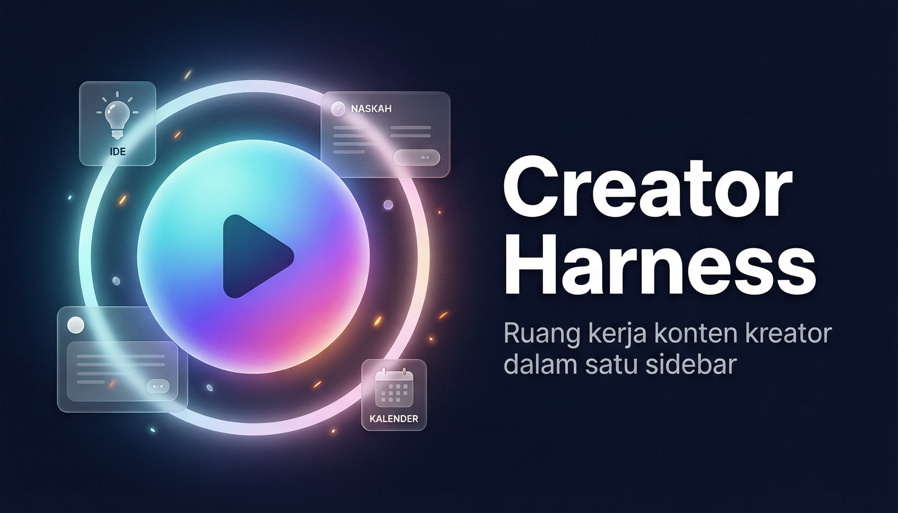
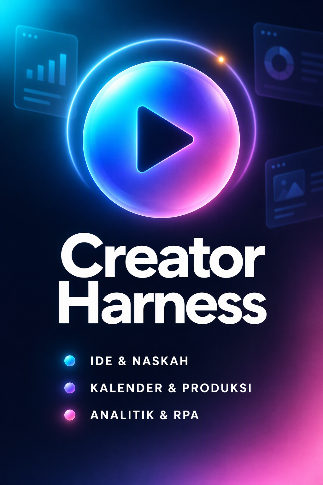

# Creator Harness

**Ruang kerja Konten Kreator dalam satu sidebar.** Ide, naskah, kalender, produksi, panen aset, brand kit, deal, analitik, dan otomasi halaman — semuanya tanpa berpindah tab.

Dibangun mengikuti **Harness Extension Standard v1.5** (`aisac-id/harness-extension`): Manifest V3, sidebar 25% di kanan, Shadow DOM, tiga mode tampilan, panel lazy, lapisan RPA, scraper pipeline, multi-provider LLM, SecretVault, lisensi offline Ed25519, dan onboarding 12 langkah dengan demo nyata.

## Brand & visual

<p align="center">
  
</p>

<p align="center">
  
</p>

<p align="center">
  
</p>

<p align="center">
  
</p>

## Fitur

| Panel | Yang bisa dilakukan |
|---|---|
| **Studio** | Ringkasan hari ini, aksi cepat, dan status ruang kerja |
| **Ide** | Simpan ide/hook, saring status, buat ide massal dengan AI |
| **Naskah** | Editor naskah per platform/format, estimasi durasi baca, template |
| **Kalender** | Jadwal konten mingguan, status, dan filter tanggal |
| **Produksi** | Checklist produksi per konten, progres langkah, catatan syuting |
| **Panen** | Ambil gambar, teks, tabel, dan metadata dari halaman aktif |
| **Data** | Preview dataset, analisis, galeri, pencarian, dan export |
| **Riset** | Riset audiens/pesaing dengan AI dari konteks halaman |
| **Brand** | Profil brand, niche, audiens, CTA, gaya bahasa, produk |
| **Deal** | Pipeline kerja sama, rate card, status, dan invoice |
| **Analitik** | Catat metrik harian, lihat tren, ringkasan pendapatan |
| **RPA** | Script otomasi JSON: klik, isi, scroll, tunggu, ekstrak |
| **Koneksi** | Provider AI, SecretVault, Platform Bridge, import `.env` |
| **Setelan** | Semua perilaku aplikasi, pencarian, reset, export/import |

Tambahan:

- **Tiga mode**: rail 56px, sidebar 25% (min 280px, maks 420px), dan layar penuh 100%.
- **Shortcut**: `Alt+Shift+S` toggle sidebar, `Alt+Shift+F` layar penuh, `Esc` keluar dari layar penuh.
- **Onboarding 12 langkah** (`1/12` … `12/12`) dengan demo halaman lokal, panen gambar nyata, export nyata, uji LLM, uji platform, dan demo RPA. Bisa dilewati, dilanjutkan, dan diulang.
- **Context menu**: simpan ide dari seleksi, panen halaman, buka sidebar.
- **Tanpa build step**, tanpa CDN, tanpa remote code, tanpa telemetry.

## Instalasi (unpacked)

1. Unduh/clone repo ini.
2. Buka `chrome://extensions` (Chrome/Edge/Brave).
3. Aktifkan **Developer mode**.
4. Klik **Load unpacked** dan pilih folder repo (berisi `manifest.json`).
5. Klik ikon **Creator Harness** di toolbar, atau tekan `Alt+Shift+S`.
6. Ikuti onboarding 12 langkah. Untuk demo, buka `demo/index.html` lewat server lokal (`python3 -m http.server`) atau langsung dari halaman apa pun.

> Chrome minimum: **116**. Extension berjalan dari folder apa adanya; tidak perlu `npm install`.

## Izin & alasan

| Izin | Dipakai untuk |
|---|---|
| `storage`, `unlimitedStorage` | Menyimpan pengaturan, koleksi, dan dataset di IndexedDB lokal |
| `downloads` | Export dataset (JSON/CSV/MD/TXT/ZIP) dan unduhan gambar hasil panen |
| `tabs` | Membaca judul/URL tab aktif untuk panen dan konteks halaman |
| `alarms` | Flush outbox Platform Bridge dan badge tanpa polling liar |
| `contextMenus` | Aksi “Simpan ide”, “Panen halaman”, “Buka sidebar” |
| `clipboardWrite` | Menyalin naskah/hasil |
| `host_permissions: http/https` | Menyuntikkan sidebar dan menjalankan panen/RPA di halaman yang dibuka user |

Extension **tidak** meminta akses ke `file://`, `chrome://`, atau riwayat browser. Semua data tetap di perangkat.

## AI & SecretVault

Provider yang didukung: **OpenAI-compatible** (OpenAI, Groq, DeepSeek, OpenRouter, xAI, dll.), **Anthropic**, **Google Gemini**, dan **Ollama lokal**. Provider baru cukup satu class; hub tidak berubah.

- Kunci API disimpan **terenkripsi AES-GCM 256** di `SecretVault`, dengan kunci turunan **PBKDF2 600.000 iterasi** (atau device key). Kunci tidak pernah masuk log, export default, atau sync.
- Import `.env` tersedia di **Setelan → Koneksi**. Contoh ada di `.env.example`.
- Ada fallback berurutan, streaming, batas biaya harian, dan mode **local-only**.
- Permintaan AI dikirim langsung ke provider pilihan user. Tidak ada server perantara milik extension.

## Panen data & hak cipta

Panen berjalan **RPA-first**, tanpa API/MCP: halaman aktif dibaca oleh content script, hasil masuk satu jalur `ScraperHub → DataPipeline → LibraryStore (IndexedDB) → panel Data`.

- Setiap item menyimpan **provenance** (URL sumber, waktu, judul) dan melewati clean/dedupe.
- Ada pacing sopan, batas jumlah, dan opsi unduh gambar.
- **Gunakan hanya pada konten yang kamu berhak akses/ambil.** Patuhi robots.txt, terms of service, hak cipta, dan privasi. Jangan gunakan untuk scraping massal, membobol login, atau menyebarkan ulang karya orang lain tanpa izin.

## Platform Bridge (opsional)

Platform dapat mengirim job RPA ke extension melalui **ingest token**, lalu extension bekerja di sesi login user dan mengirim hasil ke endpoint platform.

- Default **OFF**; wajib **HTTPS** (`127.0.0.1` hanya untuk development).
- Token disimpan di SecretVault; setiap kiriman memakai `idempotencyKey` dan **outbox queue**.
- Outbox flush lewat alarm, bukan polling agresif; otomatis berhenti saat sesi terblokir.
- **Hanya aktifkan pada akun/platform yang kamu miliki atau yang mengizinkan otomasi.** Banyak platform melarang otomasi; pelanggaran ToS adalah tanggung jawab operator.

## Lisensi & edition

Lisensi diverifikasi **offline** dengan **Ed25519** — tidak ada data lisensi yang dikirim ke server.

| Edition | Isi |
|---|---|
| **Free** | Semua data tetap bisa dibuka dan diekspor. Batas item: 25 ide, 5 naskah, 20 slot kalender, 3 deal, 50 metrik. Tanpa AI/Platform/invoice. |
| **Pro** | AI multi-provider, panen & export lanjutan (ZIP), invoice, Platform Bridge. 1 pengguna. |
| **Bundle** | Fitur Pro untuk beberapa seat/tim kecil. |
| **Enterprise** | White-label, seat besar, dukungan prioritas. |

- **Trial 14 hari** aktif otomatis saat pertama dipakai; fitur Pro terbuka selama trial.
- Aktivasi: **Lisensi → tempel kode `CH1.xxxxx.yyyyy` → Aktifkan**. Kode terikat ke edition, masa berlaku, dan penerima.
- Penerbitan kode oleh pemilik: `node tools/sign-license.mjs --key /secure/license-private.pem --edition pro --to "Nama" --exp 2027-12-31`. **Private key tidak pernah masuk repo** (lihat `.gitignore`).
- Data user **tidak pernah dikunci** saat trial habis atau lisensi tidak valid.
- Harga, kode, invoice, dan white-label diatur oleh pembuat (`aisac-id`). Hubungi lewat [Issues](https://github.com/aisac-id/creator-extension/issues).
- **Refund**: karena lisensi bersifat offline, refund diberikan bila kode **belum diaktifkan** dan diminta dalam 7 hari setelah pembelian. Kode yang sudah dipakai tidak dapat ditarik kembali; hubungi dukungan untuk kasus khusus.

## Privasi & keamanan

- Tidak ada analytics, telemetry, atau iklan.
- Data koleksi, dataset, dan pengaturan disimpan lokal di IndexedDB/`chrome.storage`.
- Secret dienkripsi di SecretVault; export pengaturan mengecualikan secret secara default.
- Tidak ada `eval`, remote script, CDN, atau kode yang di-inject dari server.
- Sidebar berjalan di **Shadow DOM** + iframe origin extension, sehingga CSS halaman tidak bocor ke UI dan sebaliknya.

## Kepatuhan Harness v1.5

- [x] Semua file `.js/.css/.html` ≤ 300 LoC; total unpacked < 500 KB
- [x] Manifest V3, service worker modular, tanpa build step
- [x] Sidebar 25% kanan + rail + fullscreen, Shadow DOM, tab vertikal, panel lazy
- [x] Full Settings: pencarian, reset, export/import, test connection, tanpa magic number
- [x] RPA lengkap: `SelectorEngine`, `ActionLibrary`, `RpaEngine`, `ScriptStore`, export/import JSON
- [x] Scraper + `DataPipeline` + `LibraryStore` + panel Data + provenance + pacing
- [x] LLM multi-provider + fallback + streaming + batas biaya + privasi per tugas
- [x] SecretVault AES-GCM/PBKDF2, import `.env`, `.gitignore`, tanpa secret hardcoded
- [x] Onboarding 12 langkah bernomor + demo first-run + guided tour + bisa diulang
- [x] Lisensi offline Ed25519, trial 14 hari, edition, data tidak terkunci, white-label config
- [x] Tanpa polling liar, `eval`, CDN eksternal, atau token di repo

## Struktur repo

```
manifest.json          # MV3, permissions, commands, content scripts
background/            # Service worker: menu, shortcut, alarm, outbox
content/               # ContentBridge (Shadow DOM/iframe), PageHarvest, PageRpa
sidebar/               # UI sidebar, 14 panel, onboarding, modal, CSS
core/                  # Storage, Settings, SecretVault, MessageBus, AppError
rpa/                   # SelectorEngine, ActionLibrary, RpaEngine, ScriptStore
scrapers/              # ScraperHub, Image/Text scraper, FileDownloader
pipeline/              # DataPipeline, Analysis, Export, LibraryStore, ZipWriter
llm/                   # LlmHub, provider, prompt, SSE parser
license/               # Ed25519 verifier + LicenseService
connectors/            # ConnectionHub + PlatformBridge (outbox)
services/              # Workspace, BrandStore
config/                # Branding, licensing, daftar platform/format/status
demo/                  # Halaman demo lokal untuk onboarding & QA
tools/                 # check.mjs (LoC/manifest) dan pack.mjs (ZIP store)
```

## Pengembangan

```bash
node tools/check.mjs     # cek 300 LoC, sintaks, struktur HTML, referensi manifest
node tools/pack.mjs      # buat dist/creator-harness-1.0.0.zip
```

Tidak ada dependency runtime. `package.json` hanya untuk tooling Node.

## Changelog

Lihat [CHANGELOG.md](CHANGELOG.md).

## Lisensi

Kode berlisensi [MIT](LICENSE). Nama, logo, dan materi brand `Creator Harness` milik `aisac-id`; kode lisensi komersial diatur terpisah.
